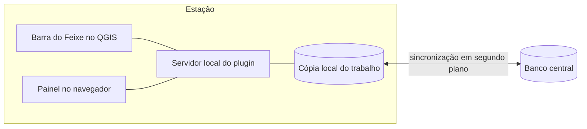

# Feixe

**Controle de cargas de trabalho para a produção cartográfica, dentro do QGIS.**

O Feixe é um plugin do QGIS para planejar, executar, controlar a qualidade e acompanhar a produção cartográfica do IBGE. Ele divide o trabalho em cargas pequenas e padronizadas, mostra a cada pessoa o que é dela no mapa em que ela já trabalha e dá ao supervisor uma visão clara de quem está com o quê, em que etapa está cada lote e o que espera uma decisão. Funciona com e sem rede.

**[Manual do Feixe](https://paschendale.github.io/feixe/)** · [Instalação](https://paschendale.github.io/feixe/instalar.html) · [Versões](https://github.com/paschendale/feixe/releases)

## O que ele faz

- **Cargas de trabalho na grade estatística.** Cada carga é uma célula inteira da grade estatística oficial, com área igual em todo o país e geocódigo nacional, no tamanho da atividade (5 km para hidrografia, 2,5 km para áreas edificadas). O andamento fica comparável entre pessoas, temas e regiões.
- **Lotes: folhas e áreas livres.** O trabalho se organiza em folhas da articulação 1:100.000 ou em lotes livres (bacias, municípios, qualquer polígono), criados de uma seleção no QGIS, com as cargas geradas na hora.
- **Fluxos configuráveis.** Cada equipe monta o seu fluxo por projeto e tema (aquisição, controle de qualidade, revisão, correção de inspeção, correção topológica, envio à inspeção externa). O supervisor decide cada passo; o Feixe mostra o que está pronto e sugere, sem andar sozinho.
- **Distribuição e filas.** O supervisor entrega cargas a cada pessoa e deixa uma fila de lotes; quando um lote acaba, o próximo chega sozinho.
- **Execução no próprio mapa.** Próxima carga, concluir e pular direto da barra do QGIS, com atalhos de teclado e uma simbologia que não esconde a imagem.
- **Controle de qualidade pelo manual de amostragem.** Planos por elemento de qualidade (comissão, omissão, nome geográfico, classificação, consistência topológica), com tamanho de amostra pelo nível de inspeção e pelo limite de qualidade aceitável, sorteio sem repetir células, avaliação conforme ou não conforme, ocorrências no mapa, resultado contra o número de aceitação e nível de conformidade contra a fração crítica.
- **Retorno a quem executou.** As ocorrências chegam a quem fez o trabalho para ciência; a revisão seguinte é feita por outra pessoa, sem ver as ocorrências anteriores, salvo decisão do supervisor. Na correção de inspeção, a equipe varre e trata cada ocorrência.
- **Offline de verdade.** Quem executa e quem avalia continuam trabalhando sem rede; o Feixe guarda tudo localmente e sincroniza em segundo plano quando a conexão volta, com cada conflito registrado para o supervisor.
- **Status nacional.** Cada lote tem, além da etapa local, um status comum a todas as equipes, para a visão de conjunto.

## Como funciona

O Feixe tem duas janelas: a **barra**, dentro do QGIS, com as ações de alta frequência, e o **painel**, no navegador, para planejar, distribuir, acompanhar e decidir. O painel é servido pelo próprio plugin, só para o computador local, e abre no navegador padrão.

- O trabalho de cada pessoa fica numa cópia local (GeoPackage). As ações gravam nela primeiro e vão ao banco central em segundo plano, por isso a barra responde na hora, com ou sem rede.
- Usuários, perfis e projetos vêm do cadastro que já existe no sistema de gerenciamento de bases cartográficas. O Feixe não tem cadastro paralelo: o papel de cada pessoa (quem executa, quem avalia, supervisor, gerente) vem do perfil dela. Os perfis são cumulativos: quem avalia também executa, e o supervisor também avalia e executa.
- O banco do Feixe roda em PostgreSQL com PostGIS e é compatível também com as versões mais antigas usadas nas gerências estaduais.

## Instalação

Requisitos: QGIS 3.22 ou mais novo (Windows ou macOS) e usuário e senha do banco de dados cartográfico. Nada mais a instalar: o Feixe usa só o que vem com o QGIS.

1. Em **Complementos › Gerenciar e instalar complementos › Configurações**, adicione o repositório `https://paschendale.github.io/feixe/plugins.xml`.
2. Instale o **Feixe**.
3. Na barra do Feixe, clique em **Conectar ao Feixe** e informe usuário e senha.

O passo a passo completo, com a senha mestra do QGIS e a instalação pelo arquivo zip, está no [manual](https://paschendale.github.io/feixe/instalar.html).

## Segurança e privacidade

- O painel só responde no próprio computador (`127.0.0.1`), com um token por sessão.
- A senha fica no gerenciador de autenticação do QGIS, protegida pela senha mestra. Não há senha em arquivo nem no código.
- O acesso ao banco segue os papéis que já existem nele: cada pessoa vê e altera só o que o perfil dela permite.

## Banco de dados

Os scripts do banco e o roteiro de aplicação para administradores estão em [`feixe/db`](feixe/db/README-DBA.md).

## Licença

[GPL-3.0](LICENSE).
