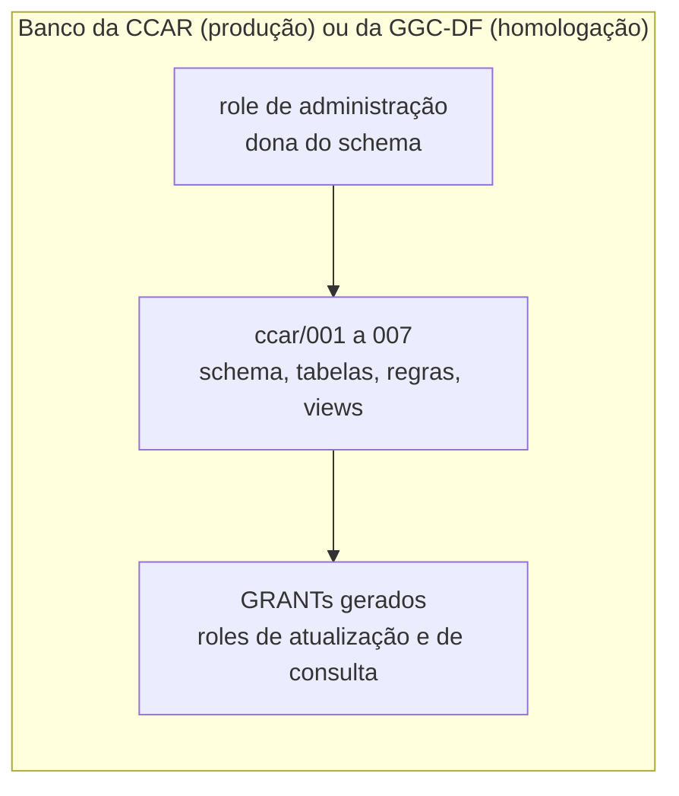

# Pacote de banco do Feixe

Este diretório tem tudo o que precisa ser aplicado no banco para o Feixe funcionar: o schema `mapcartacomp` no banco da CCAR, onde ficam os dados (a única cópia autoritativa). Os scripts estão prontos; nada precisa ser desenhado. Em produção o plugin lê e escreve só no banco da CCAR; nada é criado no banco das GGCs.

A homologação (o piloto do DF) roda no banco da GGC-DF, que é PostgreSQL 9.6 e já tem o `mapcartctrl` sincronizado com o da CCAR. O pacote é o mesmo e se aplica do mesmo jeito; só muda a conexão. No fim do piloto, o schema vai para o banco da CCAR (por `pg_dump -n mapcartacomp` ou reaplicando as migrações e a conversão do DF).



## Conteúdo

| Arquivo | O que faz |
|---|---|
| `ccar/001_schema.sql` | Schema `mapcartacomp` e `schema_version` (controle das migrações) |
| `ccar/002_referencias.sql` | Tema, fase (com carga inicial), atividade, fluxo e etapas (com o padrão do plano de CQ: nível de inspeção, LQA, fração crítica), usuários do Feixe, calendário |
| `ccar/003_lotes.sql` | Lotes (folhas e lotes livres), passagens por etapa e histórico |
| `ccar/004_cargas_cq.sql` | Planos de amostragem (um por atividade em cada passagem, com a fração crítica usada), cargas de trabalho, amostras, ocorrências de inspeção (com a passagem de CQ e a carga avaliada) e a fila de folhas por pessoa |
| `ccar/005_sync_log.sql` | Registro da sincronização |
| `ccar/006_regras.sql` | Triggers: datas de conclusão, avaliação e tratamento da ocorrência, passagem de CQ e carga avaliada da ocorrência, auditoria, derivação do status nacional, recusa de carga fora da folha ou de atividade fora da etapa |
| `ccar/007_views.sql` | Views de compatibilidade (`vw_*`, filtradas pelo usuário), de acompanhamento (`ctrl_*`) e `vw_carga_supervisao` (cargas da unidade para o supervisor, só leitura) |

Scripts auxiliares (na raiz do repositório): `scripts/db/aplicar.py` (aplica as migrações que faltam) e `scripts/db/gerar_grants.py` (gera os GRANTs para as roles de atualização e de consulta).

## Pré-requisitos

- Banco da CCAR com PostGIS 2.3 ou mais novo (as funções da grade estatística usam `ST_Transform` com a projeção em texto, sem SRID cadastrado) e o schema `mapcartctrl` (o Feixe referencia `t_projeto`, `t_articulacao_scn`, `t_usuario` e `t_qua_medidadequalidade`, sem copiá-los).
- Três roles, no padrão adotado pela DTI para schemas novos:
  - **administração**, dona do schema `mapcartacomp`. Ela precisa de `USAGE` no schema `mapcartctrl` e de `SELECT` e `REFERENCES` em `mapcartctrl.t_projeto`, `mapcartctrl.t_articulacao_scn`, `mapcartctrl.t_usuario`, `mapcartctrl.t_prd_perfil_usuarioprojeto` e `mapcartctrl.t_qua_medidadequalidade`: as chaves estrangeiras apontam para essas tabelas e as funções `SECURITY DEFINER` do Feixe as leem como dona. Quem aplica as migrações é membro dela (o usuário pessoal de quem mantém o Feixe recebe `GRANT <role_adm> TO <usuario>`);
  - **atualização**, que agrupa SELECT, INSERT, UPDATE e DELETE nas tabelas do schema. Quem usa o Feixe é membro dela;
  - **consulta** (`_cons`), só com SELECT, para quem acompanha por fora do plugin.
- O `002` semeia o catálogo de CQ com os elementos núcleo da GCQ procurando pelo nome em `mapcartctrl.t_qua_medidadequalidade` (Comissão, Omissão, Nome Geográfico, Correção da Classificação, Consistência Topológica); se algum faltar, a aplicação para com a lista dos ausentes.
- Definir quem entra na role de atualização: as roles de projeto que já reúnem as pessoas da produção cartográfica (`GRANT <role_atualizacao> TO <role_existente>`) ou cada usuário. Os scripts do Feixe não criam roles.
- Python 3 com psycopg2: serve o Python do QGIS (no Windows, o OSGeo4W Shell). Não precisa de `psql`, `bash` nem acesso ao sistema operacional do servidor. O gerador de GRANTs usa só Python 3, sem pacotes extras.

## Aplicação (homologação no banco da GGC-DF, produção no banco da CCAR)

1. Criar o schema, se ainda não existir, já com o dono definido: `CREATE SCHEMA mapcartacomp AUTHORIZATION <role_adm>;` (o `001` usa `IF NOT EXISTS` e não recria).
2. Aplicar as migrações, conectado com um usuário membro da role de administração e assumindo essa role (`--role`), para que os objetos fiquem em nome dela:

   ```bash
   python3 scripts/db/aplicar.py --role <role_adm> "host=<host> port=<porta> dbname=<banco> user=<usuario>"
   ```

   Sem a senha na conexão, o script pede no terminal. Ele lê a versão atual em `mapcartacomp.schema_version`, aplica só as migrações que faltam, todas numa transação (entram todas ou nenhuma), e registra cada uma. Rodar de novo sem migrações novas não faz nada. Para conferir antes sem mudar nada, use `--ensaio`: aplica as migrações que faltam numa transação e desfaz no fim. Sem o script, aplicar com `psql -1 -v ON_ERROR_STOP=1 -f` cada arquivo em ordem, depois de `SET ROLE <role_adm>`, e inserir a linha correspondente em `schema_version (versao, nome)`.
3. Gerar e aplicar os GRANTs (uma role por linha em cada arquivo):

   ```bash
   python3 scripts/db/gerar_grants.py --roles atualizacao.txt --consulta consulta.txt > grants.sql
   ```

   e rodar o `grants.sql` como a role de administração (no pgAdmin, DBeaver ou `psql -v ON_ERROR_STOP=1 -f grants.sql`). Reaplicar depois de cada migração nova e quando uma role nova precisar de acesso. GRANT repetido não tem efeito.

### Acesso

Nesta versão o banco não restringe linhas: quem tem os GRANTs lê e altera os dados do Feixe de todas as GGCs. Todas as roles de atualização recebem o mesmo acesso: leitura e escrita nas tabelas do Feixe, exceto `schema_version` e `fase`, que são só de leitura. As roles de consulta só leem, inclusive as views. Quem é APM, avaliador, supervisor ou gerente é decidido pelo plugin, a partir dos perfis do SGBC em `mapcartctrl` e da tabela `mapcartacomp.usuario_feixe`, e não pelas roles do banco.

As views `vw_*` (menos `vw_carga_supervisao`, só leitura e limitada pela RLS por UF) filtram pelo usuário conectado e são editáveis (por RULE): quem continuar operando direto no QGIS conclui cargas e avalia amostras por elas, como hoje no `*_apoio`. Inserir ocorrência pela `vw_cq_inspecao` exige o campo `uuid` preenchido (no QGIS, valor padrão `uuid()`); o banco nunca gera uuid.

## Rollback

- Banco da CCAR antes de ter dados de produção: `DROP SCHEMA mapcartacomp CASCADE;` volta ao estado anterior (nada fora do schema é alterado pelas migrações, exceto os GRANTs nas roles, que somem com o schema).
- Banco da CCAR com dados: as migrações só acrescentam; voltar uma migração é restaurar o backup feito antes de aplicá-la. Faça `pg_dump -n mapcartacomp` antes de cada atualização.

## Checklist de validação (homologação e produção)

1. `SELECT max(versao) FROM mapcartacomp.schema_version;` devolve a versão esperada pela release do plugin.
2. `SELECT codigo, status_nacional FROM mapcartacomp.fase ORDER BY ordem;` devolve as 7 fases.
3. Conectado como membro da role de atualização: `SELECT count(*) FROM mapcartacomp.lote;` funciona; `UPDATE mapcartacomp.fase SET nome = nome;` é recusado.
4. Conectado como membro da role de consulta: `SELECT count(*) FROM mapcartacomp.lote;` funciona; `UPDATE mapcartacomp.lote SET nome = nome;` é recusado.
5. Conectado como alguém fora das roles: `SELECT count(*) FROM mapcartacomp.lote;` é recusado.
6. No plugin, o diálogo de usuário e senha conecta e o painel abre sem aviso de versão de schema.
