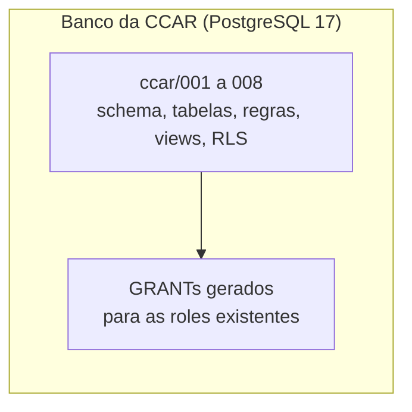

# Pacote de banco do Feixe

Este diretório tem tudo o que precisa ser aplicado no banco para o Feixe funcionar: o schema `mapcartacomp` no banco da CCAR, onde ficam os dados (a única cópia autoritativa). Os scripts estão prontos; nada precisa ser desenhado. O plugin lê e escreve só no banco da CCAR; nada é criado no banco das GGCs.



## Conteúdo

| Arquivo | O que faz |
|---|---|
| `ccar/001_schema.sql` | Schema `mapcartacomp` e `schema_version` (controle das migrações) |
| `ccar/002_referencias.sql` | Tema, fase (com carga inicial), atividade, fluxo e etapas, usuários do Feixe, calendário |
| `ccar/003_lotes.sql` | Lotes (folhas e lotes livres), passagens por etapa, histórico, cargas de trabalho |
| `ccar/004_cq.sql` | Planos de amostragem, amostras e ocorrências de inspeção |
| `ccar/005_sync_log.sql` | Registro da sincronização |
| `ccar/006_regras.sql` | Triggers: datas de conclusão e avaliação, auditoria, derivação do status nacional |
| `ccar/007_views.sql` | Views de compatibilidade (`vw_*`, filtradas pelo usuário) e de acompanhamento (`ctrl_*`) |
| `ccar/008_rls.sql` | Row level security por UF |

Scripts auxiliares (na raiz do repositório): `scripts/db/aplicar.sh` (aplica as migrações que faltam) e `scripts/db/gerar_grants.py` (gera os GRANTs para as roles reais).

## Pré-requisitos

- Banco da CCAR com PostGIS e o schema `mapcartctrl` (o Feixe referencia `t_projeto`, `t_articulacao_scn` e `t_usuario`, sem copiá-los).
- Definir a role dona do schema `mapcartacomp` (a mesma role administrativa dos schemas `*_apoio`). Ela precisa de `REFERENCES` em `mapcartctrl.t_projeto`, `mapcartctrl.t_articulacao_scn` e `mapcartctrl.t_usuario` e é quem aplica as migrações. O dono não passa pelas políticas de RLS.
- Lista das roles de grupo existentes (`role_<projeto><unidade>_atua` e `_sup`). Nenhuma role nova é criada pelo Feixe.
- Cliente `psql` (qualquer versão a partir da 9.6) e `bash`; o gerador de GRANTs usa só Python 3 sem pacotes extras.

## Aplicação no banco da CCAR

1. Criar o schema, se ainda não existir, já com o dono definido: `CREATE SCHEMA mapcartacomp AUTHORIZATION <role_dona>;` (o `001` usa `IF NOT EXISTS` e não recria).
2. Aplicar as migrações, conectado como a role dona:

   ```bash
   scripts/db/aplicar.sh "host=<host> port=<porta> dbname=<banco> user=<role_dona>"
   ```

   O script lê a versão atual em `mapcartacomp.schema_version`, aplica só as migrações que faltam, todas numa transação (entram todas ou nenhuma), e registra cada uma. Rodar de novo sem migrações novas não faz nada. Para conferir antes sem mudar nada, use `--ensaio`: aplica as migrações que faltam numa transação e desfaz no fim. Sem o script, aplicar com `psql -1 -v ON_ERROR_STOP=1 -f` cada arquivo em ordem e inserir a linha correspondente em `schema_version (versao, nome)`.
3. Gerar e aplicar os GRANTs para as roles reais:

   ```bash
   psql "<conexão>" -At -c "SELECT rolname FROM pg_roles WHERE rolname ~ '^role_.+_(atua|sup)$' ORDER BY 1" > roles.txt
   python3 scripts/db/gerar_grants.py --roles roles.txt > grants.sql
   psql "<conexão>" -v ON_ERROR_STOP=1 -f grants.sql
   ```

   Reaplicar quando surgir uma role nova (projeto ou GGC nova). GRANT repetido não tem efeito.

### O que cada role pode fazer

As políticas de RLS (`008_rls.sql`) decidem quais linhas; os GRANTs decidem quais tabelas e colunas.

| Quem | Vê | Altera |
|---|---|---|
| Membro de `_atua` da UF | Linhas da própria UF | Conclui as próprias cargas, avalia as amostras das próprias cargas de CQ, registra ocorrências e marca ocorrências como tratadas; exclui só as ocorrências que registrou |
| Membro de `_sup` da UF | Linhas da própria UF | Tudo de planejamento na própria UF: lotes, etapas, cargas, planos, fluxos, calendário, equipe dos usuários lotados na UF |
| Gerente (marcado em `mapcartacomp.usuario_feixe`, membro de alguma `_atua`) | Todas as UFs | O mesmo que a sua role |

A UF de quem consulta vem das roles de que ele é membro: a sigla é o fim do nome da unidade (`role_bc100ggcdf_atua` dá DF, `role_bc100grj_sup` dá RJ). Se a convenção real de nomes for outra, ela está isolada na função `mapcartacomp.f_ufs`.

As views `vw_*` filtram pelo usuário conectado e são editáveis (por RULE): quem continuar operando direto no QGIS conclui cargas e avalia amostras por elas, como hoje no `*_apoio`. Inserir ocorrência pela `vw_cq_inspecao` exige o campo `uuid` preenchido (no QGIS, valor padrão `uuid()`); o banco nunca gera uuid.

## Rollback

- Banco da CCAR antes de ter dados de produção: `DROP SCHEMA mapcartacomp CASCADE;` volta ao estado anterior (nada fora do schema é alterado pelas migrações, exceto os GRANTs nas roles, que somem com o schema).
- Banco da CCAR com dados: as migrações só acrescentam; voltar uma migração é restaurar o backup feito antes de aplicá-la. Faça `pg_dump -n mapcartacomp` antes de cada atualização.

## Checklist de validação (homologação e produção)

1. `SELECT max(versao) FROM mapcartacomp.schema_version;` devolve a versão esperada pela release do plugin.
2. `SELECT codigo, status_nacional FROM mapcartacomp.fase ORDER BY ordem;` devolve as 7 fases.
3. `SELECT relname, relrowsecurity FROM pg_class WHERE relnamespace = 'mapcartacomp'::regnamespace AND relkind = 'r' ORDER BY 1;`: RLS ligado em todas as tabelas, exceto `schema_version`, `tema`, `fase` e `atividade`.
4. Conectado como um membro de `_atua` de uma UF: `SELECT DISTINCT uf FROM mapcartacomp.lote;` devolve só a UF dele; `INSERT` em `mapcartacomp.lote` é recusado.
5. Conectado como um membro de `_sup`: consegue criar um lote livre de teste na própria UF (e removê-lo); na UF de outra GGC, é recusado.
6. No plugin, o diálogo de usuário e senha conecta e o painel abre sem aviso de versão de schema.
