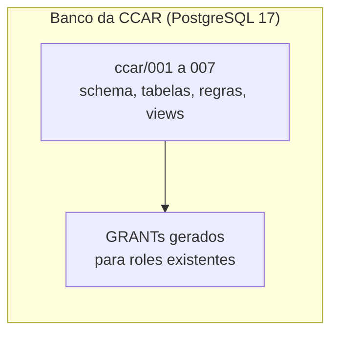

# Pacote de banco do Feixe

Este diretório tem tudo o que precisa ser aplicado no banco para o Feixe funcionar: o schema `mapcartacomp` no banco da CCAR, onde ficam os dados (a única cópia autoritativa). Os scripts estão prontos; nada precisa ser desenhado. O plugin lê e escreve só no banco da CCAR; nada é criado no banco das GGCs.



## Conteúdo

| Arquivo | O que faz |
|---|---|
| `ccar/001_schema.sql` | Schema `mapcartacomp` e `schema_version` (controle das migrações) |
| `ccar/002_referencias.sql` | Tema, fase (com carga inicial), atividade, fluxo e etapas, usuários do Feixe, calendário |
| `ccar/003_lotes.sql` | Lotes (folhas e lotes livres), passagens por etapa e histórico |
| `ccar/004_cargas_cq.sql` | Planos de amostragem, cargas de trabalho, amostras e ocorrências de inspeção |
| `ccar/005_sync_log.sql` | Registro da sincronização |
| `ccar/006_regras.sql` | Triggers: datas de conclusão e avaliação, auditoria, derivação do status nacional, recusa de carga fora da folha |
| `ccar/007_views.sql` | Views de compatibilidade (`vw_*`, filtradas pelo usuário) e de acompanhamento (`ctrl_*`) |

Scripts auxiliares (na raiz do repositório): `scripts/db/aplicar.sh` (aplica as migrações que faltam) e `scripts/db/gerar_grants.py` (gera os GRANTs para as roles reais).

## Pré-requisitos

- Banco da CCAR com PostGIS 2.3 ou mais novo (as funções da grade estatística usam `ST_Transform` com a projeção em texto, sem SRID cadastrado) e o schema `mapcartctrl` (o Feixe referencia `t_projeto`, `t_articulacao_scn`, `t_usuario` e `t_qua_medidadequalidade`, sem copiá-los).
- Definir a role dona do schema `mapcartacomp` (a mesma role administrativa dos schemas `*_apoio`). Ela precisa de `REFERENCES` em `mapcartctrl.t_projeto`, `mapcartctrl.t_articulacao_scn`, `mapcartctrl.t_usuario` e `mapcartctrl.t_qua_medidadequalidade` e é quem aplica as migrações.
- O `002` semeia o catálogo de CQ com os elementos núcleo da GCQ procurando pelo nome em `mapcartctrl.t_qua_medidadequalidade` (Comissão, Omissão, Nome Geográfico, Correção da Classificação, Consistência Topológica); se algum faltar, a aplicação para com a lista dos ausentes.
- Escolher, entre as roles que já existem na CCAR, as que vão receber acesso ao Feixe (as que reúnem as pessoas da produção cartográfica das GGCs e da CCAR). Nenhuma role nova é criada pelo Feixe.
- Cliente `psql` (qualquer versão a partir da 9.6) e `bash`; o gerador de GRANTs usa só Python 3 sem pacotes extras.

## Aplicação no banco da CCAR

1. Criar o schema, se ainda não existir, já com o dono definido: `CREATE SCHEMA mapcartacomp AUTHORIZATION <role_dona>;` (o `001` usa `IF NOT EXISTS` e não recria).
2. Aplicar as migrações, conectado como a role dona:

   ```bash
   scripts/db/aplicar.sh "host=<host> port=<porta> dbname=<banco> user=<role_dona>"
   ```

   O script lê a versão atual em `mapcartacomp.schema_version`, aplica só as migrações que faltam, todas numa transação (entram todas ou nenhuma), e registra cada uma. Rodar de novo sem migrações novas não faz nada. Para conferir antes sem mudar nada, use `--ensaio`: aplica as migrações que faltam numa transação e desfaz no fim. Sem o script, aplicar com `psql -1 -v ON_ERROR_STOP=1 -f` cada arquivo em ordem e inserir a linha correspondente em `schema_version (versao, nome)`.
3. Gerar e aplicar os GRANTs para as roles escolhidas (uma por linha em `roles.txt`):

   ```bash
   python3 scripts/db/gerar_grants.py --roles roles.txt > grants.sql
   psql "<conexão>" -v ON_ERROR_STOP=1 -f grants.sql
   ```

   Reaplicar quando uma role nova precisar de acesso. GRANT repetido não tem efeito.

### Acesso

Nesta versão o banco não restringe linhas: quem tem os GRANTs lê e altera os dados do Feixe de todas as GGCs. Todas as roles da lista recebem o mesmo acesso: leitura e escrita nas tabelas do Feixe, exceto `schema_version` e `fase`, que são só de leitura. Quem é APM, avaliador, supervisor ou gerente é decidido pelo plugin, a partir dos perfis do SGBC em `mapcartctrl` e da tabela `mapcartacomp.usuario_feixe`, e não pelas roles do banco.

As views `vw_*` filtram pelo usuário conectado e são editáveis (por RULE): quem continuar operando direto no QGIS conclui cargas e avalia amostras por elas, como hoje no `*_apoio`. Inserir ocorrência pela `vw_cq_inspecao` exige o campo `uuid` preenchido (no QGIS, valor padrão `uuid()`); o banco nunca gera uuid.

## Rollback

- Banco da CCAR antes de ter dados de produção: `DROP SCHEMA mapcartacomp CASCADE;` volta ao estado anterior (nada fora do schema é alterado pelas migrações, exceto os GRANTs nas roles, que somem com o schema).
- Banco da CCAR com dados: as migrações só acrescentam; voltar uma migração é restaurar o backup feito antes de aplicá-la. Faça `pg_dump -n mapcartacomp` antes de cada atualização.

## Checklist de validação (homologação e produção)

1. `SELECT max(versao) FROM mapcartacomp.schema_version;` devolve a versão esperada pela release do plugin.
2. `SELECT codigo, status_nacional FROM mapcartacomp.fase ORDER BY ordem;` devolve as 7 fases.
3. Conectado como membro de uma das roles da lista: `SELECT count(*) FROM mapcartacomp.lote;` funciona; `UPDATE mapcartacomp.fase SET nome = nome;` é recusado.
4. Conectado como alguém fora da lista: `SELECT count(*) FROM mapcartacomp.lote;` é recusado.
5. No plugin, o diálogo de usuário e senha conecta e o painel abre sem aviso de versão de schema.
